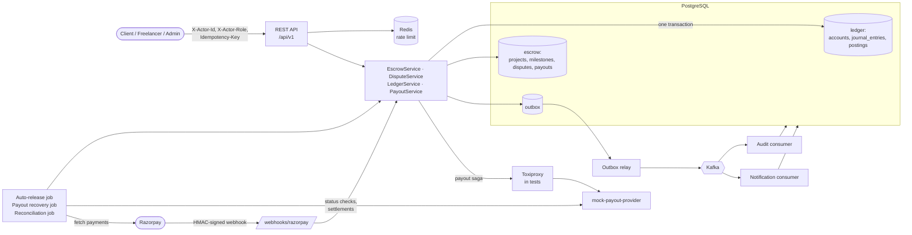
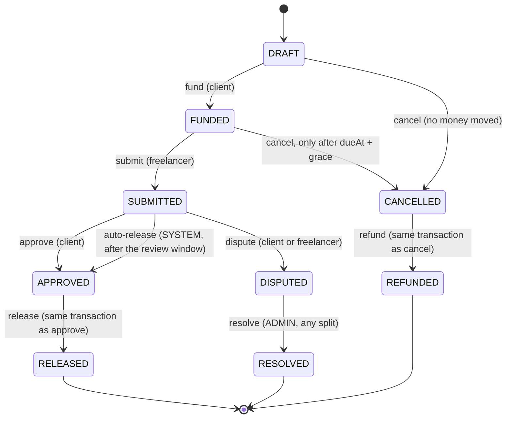
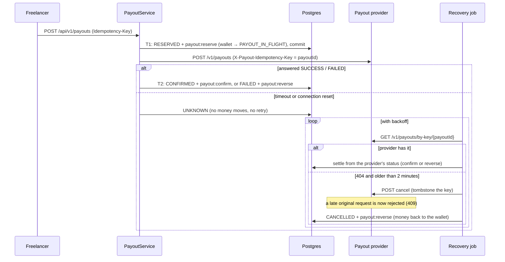

# Milestone Escrow Ledger

Freelancers get ghosted after delivering work, and clients get ghosted after paying up front.
This service holds a project's budget in escrow and releases it one milestone at a time: on the
client's approval, automatically when the client goes silent past the review window, or never
while a dispute is open. All of it runs on a double-entry ledger that always sums to zero.

[](https://github.com/SVatsa12/Milestone-escrow-ledger/actions/workflows/ci.yml)


> **Highlights**
> - **250 req/s sustained** transfers at **p99 28 ms**, 0 errors, 0 dropped, 3 of 3 runs ([REPORT](load/results/v2/REPORT.md))
> - **Saturates around 480 req/s**, where **Postgres is the bottleneck**: 192% of its 2-vCPU cap vs 127% for the app ([REPORT](load/results/v2/REPORT.md))
> - **9 chaos scenarios × 3 consecutive runs**: 0 invariant violations, 0 reconciliation mismatches ([chaos/results](chaos/results))
> - **10,000-operation property test** checks the ledger against an in-memory model ([LedgerPropertyIT](escrow-service/src/test/java/com/svatsa/escrow/ledger/LedgerPropertyIT.java))
> - **43 real bugs found by testing**, each with root cause, fix and regression test ([FINDINGS.md](chaos/FINDINGS.md), 45 entries; #43 and #44 were bugs in the tests themselves)

**Contents:** [Architecture](#architecture) · [State machine](#milestone-state-machine) ·
[Ledger](#ledger-design) · [Guarantees](#correctness-guarantees) · [Concurrency](#concurrency) ·
[Payment safety](#payment-safety) · [Benchmarks](#benchmarks) · [Chaos](#chaos-testing) ·
[Bugs found](#bugs-found-by-testing) · [Trade-offs](#trade-offs-and-next-steps) ·
[Running it](#running-it) · [Done when](#done-when)

**Stack:** Java 21, Spring Boot 3.5, PostgreSQL 16 (Flyway, `JdbcClient`, no JPA in the money
path), Kafka 4 (KRaft), Redis 7, Razorpay Java SDK (test mode). Tests use JUnit 5, Testcontainers,
jqwik, Toxiproxy and k6.

## Architecture



Every money movement is one `@Transactional` service method: the state change, the journal entry
and the outbox event commit together or not at all. Only the outbox relay calls Kafka for domain
events. In the test suite, Toxiproxy sits between the service and Postgres and between the service
and the provider, so tests can inject latency, timeouts and connection resets.

## Milestone state machine



Every transition goes through `MilestoneStateMachine` as a conditional
`UPDATE ... WHERE id = ? AND state = ?`. Zero rows updated means a conflict
(`409 INVALID_STATE_TRANSITION`), and nothing else in the transaction commits. Each transition is
recorded in `milestone_transitions` with the actor. A client can't cancel a funded milestone before
`dueAt + grace`, which protects the freelancer from a client who walks away mid-work.

## Ledger design

**Double entry.** Each money flow is exactly one journal entry with at least 2 postings that sum to
0. Accounts never change except through postings.

| type | code | may go negative | purpose |
|---|---|---|---|
| CLIENT_WALLET | `CLIENT_WALLET:{userId}` | no | client's spendable funds |
| FREELANCER_WALLET | `FREELANCER_WALLET:{userId}` | no | freelancer's earned funds |
| ESCROW | `ESCROW:{projectId}` | no | funded, not yet released |
| DISPUTE_HOLD | `DISPUTE_HOLD:{projectId}` | no | frozen by an open dispute |
| PAYOUT_IN_FLIGHT | `PAYOUT_IN_FLIGHT` | no | reserved for payouts in progress |
| PLATFORM_FEES | `PLATFORM_FEES` | no | platform revenue |
| EXTERNAL_BANK | `EXTERNAL_BANK:RAZORPAY`, `EXTERNAL_BANK:PAYOUTS` | **yes** | the outside world |

| flow | postings | idempotency key |
|---|---|---|
| Deposit captured | EXTERNAL_BANK:RAZORPAY −A, CLIENT_WALLET +A | `deposit:rzp:{razorpayPaymentId}` |
| Fund project | CLIENT_WALLET −ΣA, ESCROW +ΣA | `fund:project:{projectId}` |
| Release (approve or auto) | ESCROW −A, FREELANCER_WALLET +(A−fee), PLATFORM_FEES +fee | `release:milestone:{milestoneId}` |
| Open dispute | ESCROW −A, DISPUTE_HOLD +A | `dispute-freeze:milestone:{milestoneId}` |
| Resolve dispute | DISPUTE_HOLD −A, FREELANCER_WALLET +(F−fee), PLATFORM_FEES +fee, CLIENT_WALLET +C (F+C=A) | `dispute-resolve:{disputeId}` |
| Refund after cancel | ESCROW −A, CLIENT_WALLET +A | `refund:milestone:{milestoneId}` |
| Payout reserve | FREELANCER_WALLET −A, PAYOUT_IN_FLIGHT +A | `payout:reserve:{payoutId}` |
| Payout confirm | PAYOUT_IN_FLIGHT −A, EXTERNAL_BANK:PAYOUTS +A | `payout:confirm:{payoutId}` |
| Payout reverse | PAYOUT_IN_FLIGHT −A, FREELANCER_WALLET +A | `payout:reverse:{payoutId}` |

The fee is `amount * 500 / 10_000` (5%) with floor division, and the freelancer gets
`amount - fee`, so the split is always exact. The key is a business key, not the HTTP
`Idempotency-Key`: approving the same milestone under a new HTTP key still can't release it twice
(invariant I10).

**Why integer paise.** Every amount is a `long` count of paise in `BIGINT` columns, and every JSON
field ends in `Paise`. Floating point can't represent 0.10 exactly, and `BigDecimal` invites
mixed scales. Integers make "sums to zero" an exact comparison. Rupees appear only in display text.

**Balance is a cached projection.** `accounts.balance` exists so that a balance check and a
`FOR UPDATE` lock touch one row. Only `LedgerService.post` writes it, in the same transaction as
the postings. Invariant **I3** recomputes `SUM(postings)` for every account and compares, after
every integration test and every chaos run.

**Guards in the database**, not only in Java:
- **Balanced entries:** `postings_balanced` is a `DEFERRABLE INITIALLY DEFERRED` constraint
  trigger ([V1](escrow-service/src/main/resources/db/migration/V1__ledger.sql)). It checks the
  sum and the posting count at commit, after all postings exist. `journal_entries_have_postings`
  ([V9](escrow-service/src/main/resources/db/migration/V9__ledger_guard_fixes.sql)) rejects an
  entry with no postings.
- **Immutability:** triggers reject `UPDATE` and `DELETE` on `journal_entries` and `postings`.
  Mistakes are fixed with a new reversing entry.
- **No negative balances:** `CONSTRAINT balance_non_negative CHECK (allow_negative OR balance >= 0)`.
- **One entry per business key:** `journal_entries.idempotency_key` is `UNIQUE NOT NULL`.

## Correctness guarantees

`InvariantChecker` runs these after **every** integration test (`AbstractIntegrationTest`'s
`@AfterEach`), at the end of every chaos scenario, and at `GET /api/v1/admin/invariants`.
Reconciliation records any violation as a `LEDGER_INVARIANT` mismatch.

| | invariant | proven by |
|---|---|---|
| I1 | Every journal entry sums to 0 and has ≥ 2 postings | [LedgerSchemaIT](escrow-service/src/test/java/com/svatsa/escrow/ledger/LedgerSchemaIT.java) (unbalanced, single-posting and empty entries fail at commit), [LedgerPropertyIT](escrow-service/src/test/java/com/svatsa/escrow/ledger/LedgerPropertyIT.java) |
| I2 | The sum of all postings in the ledger is 0 | [LedgerPropertyIT](escrow-service/src/test/java/com/svatsa/escrow/ledger/LedgerPropertyIT.java) (10,000 random operations), every chaos scenario |
| I3 | `accounts.balance` = SUM(postings) for every account | [LedgerPropertyIT](escrow-service/src/test/java/com/svatsa/escrow/ledger/LedgerPropertyIT.java) (balances match an in-memory model), the after-test check (shown to fail on a corrupted balance, [FINDINGS #15](chaos/FINDINGS.md)) |
| I4 | No account without `allow_negative` goes below 0 | [LedgerSchemaIT](escrow-service/src/test/java/com/svatsa/escrow/ledger/LedgerSchemaIT.java) `nonNegativeAccountCannotGoNegative`; [ledger/ConcurrencyIT](escrow-service/src/test/java/com/svatsa/escrow/ledger/ConcurrencyIT.java) `hotAccountConcurrency` (100 parallel debits of a 3,700-paise wallet: exactly 37 succeed, balance 0) |
| I5 | No idempotency key appears twice | [ledger/ConcurrencyIT](escrow-service/src/test/java/com/svatsa/escrow/ledger/ConcurrencyIT.java) `sameKeyRaceThroughTheApiCreatesOneEntry`, [TransferIdempotencyRegressionIT](escrow-service/src/test/java/com/svatsa/escrow/ledger/api/TransferIdempotencyRegressionIT.java), chaos C3 and K2 |
| I6 | ESCROW = Σ milestones in FUNDED/SUBMITTED/APPROVED; DISPUTE_HOLD = Σ DISPUTED | [EscrowFlowIT](escrow-service/src/test/java/com/svatsa/escrow/escrow/EscrowFlowIT.java), [escrow/ConcurrencyIT](escrow-service/src/test/java/com/svatsa/escrow/escrow/ConcurrencyIT.java), chaos C6 |
| I7 | PAYOUT_IN_FLIGHT = Σ payouts in RESERVED/PROCESSING/UNKNOWN | [PayoutSagaIT](escrow-service/src/test/java/com/svatsa/escrow/payouts/PayoutSagaIT.java), chaos C1, C2, K1 |
| I8 | A CONFIRMED payout has exactly one confirm entry and no reverse; FAILED/CANCELLED have one reverse | [PayoutSagaIT](escrow-service/src/test/java/com/svatsa/escrow/payouts/PayoutSagaIT.java) `parallelRecoverySettlesEachPayoutOnce`, chaos C2, K1 |
| I9 | No outbox row stays unpublished for more than 5 minutes | [OutboxIT](escrow-service/src/test/java/com/svatsa/escrow/outbox/OutboxIT.java) `kafkaOutageIsAbsorbedByTheOutbox`, [OutboxRelayThroughputIT](escrow-service/src/test/java/com/svatsa/escrow/outbox/OutboxRelayThroughputIT.java), chaos C5 |
| I10 | Every business entry carries exactly the key its flow dictates (`release:milestone:{id}`, …) | [LedgerIdempotencyKeyIT](escrow-service/src/test/java/com/svatsa/escrow/ledger/LedgerIdempotencyKeyIT.java) (per flow: replay with a new HTTP key, then with the state guard bypassed in SQL; one entry each time) |

## Concurrency

- **Ordered locking.** `LedgerService.post` locks every account of an entry with
  `SELECT ... FOR UPDATE` in ascending id order, so two opposite transfers can't deadlock.
  [ledger/ConcurrencyIT](escrow-service/src/test/java/com/svatsa/escrow/ledger/ConcurrencyIT.java)
  `lockOrderingIsWhatPreventsTheDeadlock` forces the interleaving with a barrier: in opposite
  orders Postgres aborts one transaction with `40P01`, and in ascending order both complete.
  `noDeadlockWithOppositeTransfers` runs 200 parallel A→B / B→A transfers with zero failures.
  Implicit locks count too: a foreign-key check once broke the order
  ([FINDINGS #1](chaos/FINDINGS.md)).
- **Idempotency through the database.** The first request inserts its key into a `UNIQUE` index.
  A concurrent request with the same key blocks on that index inside Postgres until the first
  commits, then sees the row and replays the stored response (`Idempotent-Replayed: true`). The
  same key with a different body is `422 IDEMPOTENCY_KEY_REUSED`. Proof: 50 simultaneous identical
  requests give one journal entry, 50 identical responses and 49 replays (`sameKeyRaceThroughTheApiCreatesOneEntry`).
- **Jobs claim with `FOR UPDATE SKIP LOCKED`**: the auto-release job, the payout recovery job and
  the outbox relay. Any number of instances can run without claiming the same row. Approve,
  dispute and auto-release lock the milestone row first and the accounts second, so a client
  approving exactly when the job fires can't deadlock ([FINDINGS #32](chaos/FINDINGS.md),
  `AutoReleaseIT.approveVersusAutoReleaseReleasesOnce`).
- **Per-aggregate outbox ordering.** The relay keys Kafka records by `aggregateType:aggregateId`,
  so one project's events share a partition. Within a batch it marks published only each
  aggregate's prefix of acknowledged rows before the first failure. **Documented limit**
  ([FINDINGS #42](chaos/FINDINGS.md)): when a failure is reported asynchronously, a later event may
  already be on Kafka, so a consumer can see B before A's retry. Consumers dedupe by `eventId`.
  Closing that gap would serialize a busy aggregate to one ack round trip per event.

## Payment safety

**Deposits (Razorpay webhooks).** The controller takes the body as raw bytes and verifies the
`X-Razorpay-Signature` HMAC-SHA256 over exactly those bytes before parsing anything. It fails
closed if no secret is configured. Deduplication happens at two levels:
1. `webhook_events.event_id` is unique (`INSERT ... ON CONFLICT DO NOTHING`), so a redelivered event is a no-op.
2. The ledger key `deposit:rzp:{paymentId}` is unique, so even a *different* event for the same
   payment (`payment.captured` and `order.paid`) credits the wallet once.

The dedupe row, deposit update, posting and outbox event commit in one transaction. A genuine
failure answers 5xx, so Razorpay retries ([FINDINGS #26](chaos/FINDINGS.md) explains what happened
before). Chaos C4 sends 600 shuffled deliveries for 20 payments; each wallet is credited exactly once.

**Payouts: a saga that never retries blindly.**



T1 commits before the provider is called, so a crash at any point leaves a durable record for
recovery (chaos K1 kills the JVM at both points). Settling is one conditional update from a
non-terminal state, so the inline path and the recovery job can't both settle.

**Reconciliation, both ways** (`POST /api/v1/admin/recon/run?date=…`, one Asia/Kolkata day, never moves money):
- **PAYOUT_PROVIDER:** our CONFIRMED payouts against the provider's settlements. A payout the
  provider made that we recorded as FAILED or CANCELLED (and therefore refunded) is flagged as a
  **DOUBLE PAYOUT** (`MISSING_IN_LEDGER`). Other reasons: `MISSING_AT_PROVIDER`, `AMOUNT_MISMATCH`.
- **RAZORPAY:** our CAPTURED deposits against captured payments at the gateway. A missed webhook
  shows up as `MISSING_IN_LEDGER`.
- Keys match over ±1 day, so "settled 23:59, confirmed 00:01" is one match. Re-runs replace their
  own mismatches, and counts are exported as `escrow.recon.mismatches{source,reason}`.
  Covered by [ReconciliationIT](escrow-service/src/test/java/com/svatsa/escrow/recon/ReconciliationIT.java)
  (`paidButFailedIsADoublePayout`, `missedWebhookIsMissingInLedger`, midnight cases). Every chaos
  scenario ends with both sources at 0 mismatches.

## Benchmarks

k6 against the docker compose stack, median of **3 runs** (min–max) per row. Every run uses a fresh
database, and every run ended with 0 invariant violations and 0 reconciliation mismatches.
Method and caveats: [load/README.md](load/README.md). Tables: [REPORT.md](load/results/v2/REPORT.md),
data: [summary.json](load/results/v2/summary.json), [runs/](load/results/v2/runs).

**Sustainable** (transfers, constant arrival rate, 3 min):

| rate | achieved | p50 ms | p95 ms | p99 ms | failed (incl. dropped) | escrow CPU avg | postgres CPU avg |
|---|---|---|---|---|---|---|---|
| 200 req/s | 200.0 | 3.8 | 7.4 | 13.8 | 0.00% | 71% | 46% |
| **250 req/s** | **250.0** | **3.8** | **7.8** | **28.2** | **0.00%** | 84% | 53% |

**Saturation** (transfers, ramp 50 → 1000 req/s over 5 min):

| achieved | p50 ms | p95 ms | p99 ms | failed (incl. dropped) | dropped iterations |
|---|---|---|---|---|---|
| 481.4 req/s (480.6–485.7) | 6.5 | 1720.7 | 2209.7 | 8.31% | 13,085 |

**CPU evidence:** over the saturated final minute of the ramp, Postgres averaged **192%** of its
200% cap (2 vCPUs) and escrow-service **127%**. The database runs out first, and the app has
headroom. CPU % is `docker stats` per core.

**Other scenarios:** hot account (every transfer debits one wallet) holds 200 req/s at p99 195.5 ms,
which is the cost of the row lock. Replays at 200 req/s honoured 100% of resends. A mixed workload
at 150 req/s (reads, transfers, approve, dispute, payouts to the real provider) runs at p99 22.8 ms.

**Tuning** (transfers at 250 req/s):

| config | p95 ms | p99 ms | escrow CPU avg |
|---|---|---|---|
| pool 10, virtual threads | 9.5 | 51.5 | 85% |
| pool 20, virtual threads | 8.4 | 36.5 | 85% |
| pool 40, virtual threads | 9.5 | 39.6 | 85% |
| pool 10, platform threads | 7.7 | 54.0 | 62% |
| pool 20, platform threads | 7.7 | 38.0 | 60% |
| pool 40, platform threads | 7.7 | 24.6 | 63% |

**Virtual vs platform threads:** at this load the Hikari pool size makes no measurable difference.
Platform threads match virtual threads on latency and use about a quarter less escrow-service CPU.
Virtual threads also caused a real outage: Kafka consumers pinned both carrier threads of the
2-CPU container after a `kill -9` ([FINDINGS #45](chaos/FINDINGS.md)), so consumers now run on
platform threads.

**Hardware** ([HARDWARE.txt](load/results/v2/HARDWARE.txt)): Intel Core i5-12500H (12 cores / 16
threads), 15.7 GB RAM, Windows 11, Docker Desktop 28.4. Containers are capped: escrow-service
2 CPUs / 1 GB, Postgres 2 CPUs. k6 runs on the same host. **Power:** on AC with no standby for the
whole benchmark, read afterwards from the Windows event log. Rate limiting is off during benchmarks.

## Chaos testing

`python chaos/run_all.py` runs all 9 scenarios and prints
`scenario | operations | violations | mismatches | result`. Each scenario ends by checking every
invariant and reconciling its day against both the payout provider and Razorpay. It passed **3 times
in a row** with 0 violations and 0 mismatches. The table shows the most recent uninterrupted run
(run 2; the laptop slept during run 3's K2, which still passed).

| scenario | injected fault | what could go wrong without the design | result |
|---|---|---|---|
| [C1](chaos/results/C1-provider-latency-20261115T120833Z.json) provider latency | 3 s Toxiproxy latency against a 2 s read timeout, 100 payouts | blind retries pay twice | all 100 UNKNOWN; recovery confirms each with one provider POST · **0 / 0 PASS** |
| [C2](chaos/results/C2-provider-connection-reset-20261115T120849Z.json) connection reset | flapping `reset_peer` both ways; provider in a random mode | provider paid, response lost: money out with no ledger record | provider paid 60,650 paise = ledger confirmed 60,650 · **0 / 0 PASS** |
| [C3](chaos/results/C3-db-latency-and-drops-20261115T120855Z.json) DB latency and drops | 300 ± 100 ms Postgres latency, 25 connection-drop windows; client retries with the same key | a retried transfer applied twice | 329 HTTP attempts for 100 transfers; none applied twice, none applied without an ack · **0 / 0 PASS** |
| [C4](chaos/results/C4-duplicate-webhooks-20261115T121248Z.json) webhook storm | 20 payments × (25 `payment.captured` + 5 `order.paid`), 600 shuffled deliveries from 32 threads | a wallet credited 25 times | 600 × 200 OK, each wallet credited once · **0 / 0 PASS** |
| [C5](chaos/results/C5-kafka-outage-20261115T121249Z.json) Kafka outage | broker paused for 30 s during 200 escrow operations | events lost, or operations blocked on Kafka | all 200 succeeded (166 during the outage); outbox peaked at 155 pending, drained; one audit row per event · **0 / 0 PASS** |
| [C6](chaos/results/C6-state-machine-race-20261115T121349Z.json) state race | approve vs dispute vs 4 auto-release threads on 100 milestones at the exact review-window boundary | released and disputed, or released twice | 89 released (53 by auto-release), 11 disputed; exactly one entry each · **0 / 0 PASS** |
| [K1](chaos/results/K1-kill-mid-saga-AFTER_RESERVE-20261115T121403Z.json) kill after reserve | JVM halted with exit 137 after T1 commits | reserved money stuck, or the payout lost | restart, recovery tombstones the key: CANCELLED, money back · **0 / 0 PASS** |
| [K1](chaos/results/K1-kill-mid-saga-AFTER_PROVIDER_CALL-20261115T121639Z.json) kill after provider call | JVM halted with exit 137 after the provider paid | provider paid, ledger never knows | recovery finds SUCCESS at the provider: CONFIRMED in 39 s · **0 / 0 PASS** |
| [K2](chaos/results/K2-kill-under-load-20261115T121745Z.json) kill under load | `docker kill -s KILL` every 15 s of uptime under `mixed.js` for 2 min (5 kills, all exit 137) | an acknowledged request lost or applied twice | 3,528 acknowledged operations, each with exactly one journal entry · **0 / 0 PASS** |

How each fault is injected and verified: [chaos/FINDINGS.md](chaos/FINDINGS.md) (scenario notes, #44).

## Bugs found by testing

Each of these has a regression test outside the chaos tag. Full write-ups: [chaos/FINDINGS.md](chaos/FINDINGS.md).

- **#45, virtual-thread consumers starved the container after `kill -9`.** Both Kafka consumers
  ran on virtual threads and pinned the only 2 carrier threads while rejoining their group, so the
  restarted app said "Started" and never answered a request. Fix: consumers on platform threads.
- **#39, role spoofing.** The actor resolver trusted the role header, so any client could send
  `X-Actor-Role: ADMIN` and pass every admin check. Fix: the id and role are verified against `users`.
- **#26, a Razorpay deposit never credited a wallet.** The capture ran outside a transaction and
  failed, the controller still answered 200, and the dedupe row made every retry a "duplicate".
- **The H2 base class skipped 72 of 85 tests.** Tests booted H2 with Flyway off, so each new
  integration test was `@Disabled`. Moving to real Postgres exposed bugs #15–#35.
- **#42, the outbox relay could mark an event published ahead of an earlier failed one** in the
  same aggregate. Fix: only each aggregate's acknowledged prefix is marked.
- **#1, payout deadlock despite ascending lock order.** A foreign-key check took an implicit
  `KEY SHARE` lock on the wallet first.
- **#2, the provider was called inside the reservation transaction.** A crash after the provider
  paid would roll back the reservation, so money left with no ledger record.
- **#8, concurrent projects shared escrow accounts.** Accounts were named with
  `currentTimeMillis()`, and `ON CONFLICT DO NOTHING` handed one project's account to another.
- **#32, approve and auto-release could deadlock.** They locked milestone and accounts in opposite orders.
- **#15, `InvariantChecker` reported "no violations" whenever a check failed to run** (a swallowing catch).

## Trade-offs and next steps

- **Auth is a stub.** `X-Actor-Id` and `X-Actor-Role` are checked against `users` but not
  authenticated. Next: OAuth2/OIDC with the actor taken from a verified token.
- **The rate limiter uses fixed 60 s windows in Redis**, so a client can send up to 2× the limit
  across a window boundary (pinned by `RateLimiterIT.aBurstAcrossAWindowBoundaryIsCountedInTwoWindows`).
  A sliding window or token bucket would fix it.
- **Polling outbox relay.** It's simple and correct, but it adds latency and polls the database.
  Debezium (CDC on the WAL) would stream outbox rows with no polling.
- **Postings grow forever.** Next: partition `postings` by month, and snapshot balances so I3 can
  check incrementally.
- **Hot accounts** serialize on one row lock (hot-account p99 195 ms). Next: split a hot account
  into sub-accounts and sum them on read.
- **Single currency (INR).** Multi-currency needs an amount-plus-currency type and FX entries
  through an exchange account.

## Running it

**Prerequisites:** Docker, JDK 21, Python 3 (chaos and benchmarks). k6 runs in a container.

```bash
docker compose up -d                                   # postgres, kafka, redis, toxiproxy
docker compose --profile app up -d --build             # + escrow-service (:8080) and mock-payout-provider (:9090)
./mvnw -pl escrow-service spring-boot:run              # or run the service from source
```

| variable | default | purpose |
|---|---|---|
| `RATELIMIT_ENABLED` | `true` | Redis rate limiting (30/min per actor and path; payouts 5/min) |
| `HIKARI_POOL` | `20` | escrow-service connection pool (compose) |
| `VIRTUAL_THREADS` | `true` | virtual threads for request handling (compose) |
| `ESCROW_DB` | `escrow` | database name (compose; benchmarks use a fresh one per run) |
| `PAYOUT_PROVIDER_URL` | `http://localhost:9090` | payout provider base URL |
| `RAZORPAY_KEY_ID`, `RAZORPAY_KEY_SECRET`, `RAZORPAY_WEBHOOK_SECRET` | empty | Razorpay test mode. With no key id the fake gateway is used. Read from the environment when you run from source; the compose service doesn't pass them through |
| `SPRING_PROFILES_ACTIVE`, `CHAOS_CRASH_POINT` | empty, `NONE` | chaos K1 only |

**Bootstrap admin.** A fresh database has one user, seeded by Flyway `V11`: id **1**,
`bootstrap-admin`, role `ADMIN`. Only an admin can create users:

```bash
curl -X POST localhost:8080/api/v1/users \
  -H 'X-Actor-Id: 1' -H 'X-Actor-Role: ADMIN' -H 'Content-Type: application/json' \
  -d '{"name":"alice","role":"CLIENT"}'
```

Every write needs `X-Actor-Id` and `X-Actor-Role`, which must match the stored user (otherwise
`401`; the wrong user for the action is `403`). Money-moving POSTs also need an `Idempotency-Key`
(missing is `400`). Errors are RFC 9457 `ProblemDetail` with a stable `code`.

**Razorpay test mode:** keys, webhook secret and a tunnel for webhooks:
[docs/razorpay-local.md](docs/razorpay-local.md).

```bash
./mvnw verify                  # unit + integration tests (Testcontainers: real Postgres, Kafka, Redis, Toxiproxy)
./mvnw verify -Pchaos          # only the JUnit chaos scenarios C1-C6
python chaos/run_all.py        # all 9 chaos scenarios incl. kill -9 (K1, K2), about 13 minutes
python load/bench.py           # benchmarks, 3 runs each (about 3.5 hours); see load/README.md
```

## Done when

- [x] **Zero invariant violations across all chaos runs.** 9 scenarios × 3 consecutive runs, 0
  violations and 0 reconciliation mismatches in every run: [chaos/results](chaos/results)
  (27 result files, `"violations": 0, "mismatches": 0`).
- [x] **The same request sent twice never moves money twice.**
  [ledger/ConcurrencyIT](escrow-service/src/test/java/com/svatsa/escrow/ledger/ConcurrencyIT.java)
  (50 simultaneous identical requests, 1 entry),
  [LedgerIdempotencyKeyIT](escrow-service/src/test/java/com/svatsa/escrow/ledger/LedgerIdempotencyKeyIT.java)
  (every flow, even with a new HTTP key), chaos [C3](chaos/results/C3-db-latency-and-drops-20261115T120855Z.json),
  [C4](chaos/results/C4-duplicate-webhooks-20261115T121248Z.json) and
  [K2](chaos/results/K2-kill-under-load-20261115T121745Z.json), replays benchmark (100% honoured,
  [REPORT](load/results/v2/REPORT.md)).
- [x] **Disputes freeze funds, and auto-release works.**
  [DisputeIT](escrow-service/src/test/java/com/svatsa/escrow/dispute/DisputeIT.java),
  [AutoReleaseIT](escrow-service/src/test/java/com/svatsa/escrow/escrow/AutoReleaseIT.java), and chaos
  [C6](chaos/results/C6-state-machine-race-20261115T121349Z.json) (53 auto-releases and 11 disputes
  racing at the boundary, with DISPUTE_HOLD conservation checked by I6).
- [x] **README has a benchmark table and failure write-ups.** [Benchmarks](#benchmarks),
  [Chaos testing](#chaos-testing), [Bugs found by testing](#bugs-found-by-testing).

## License

MIT
